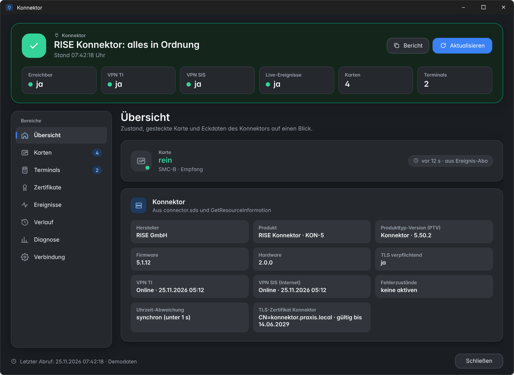
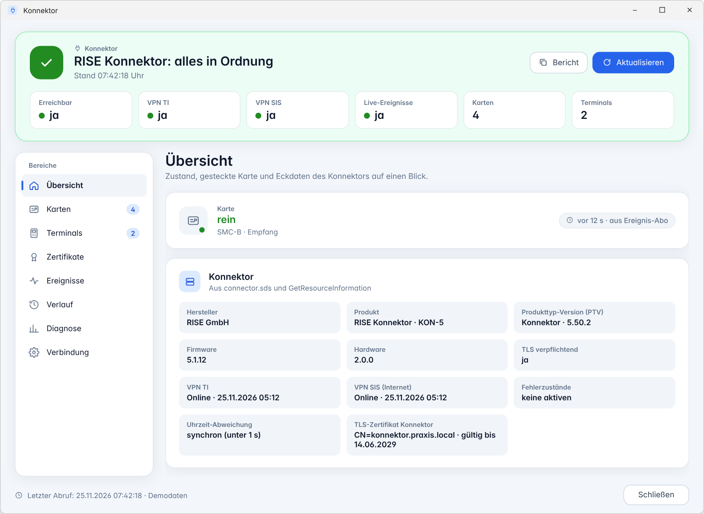
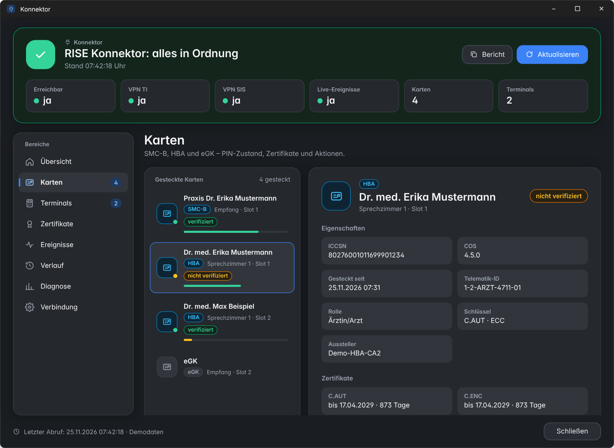
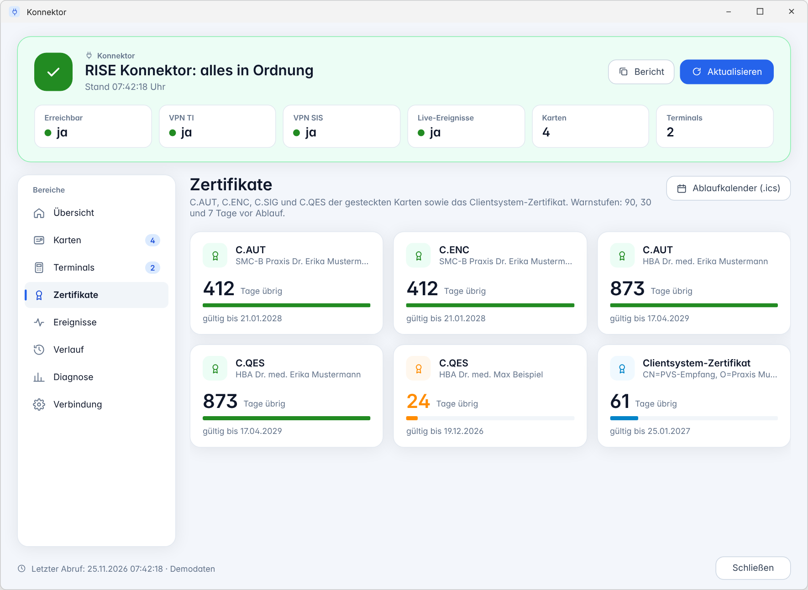
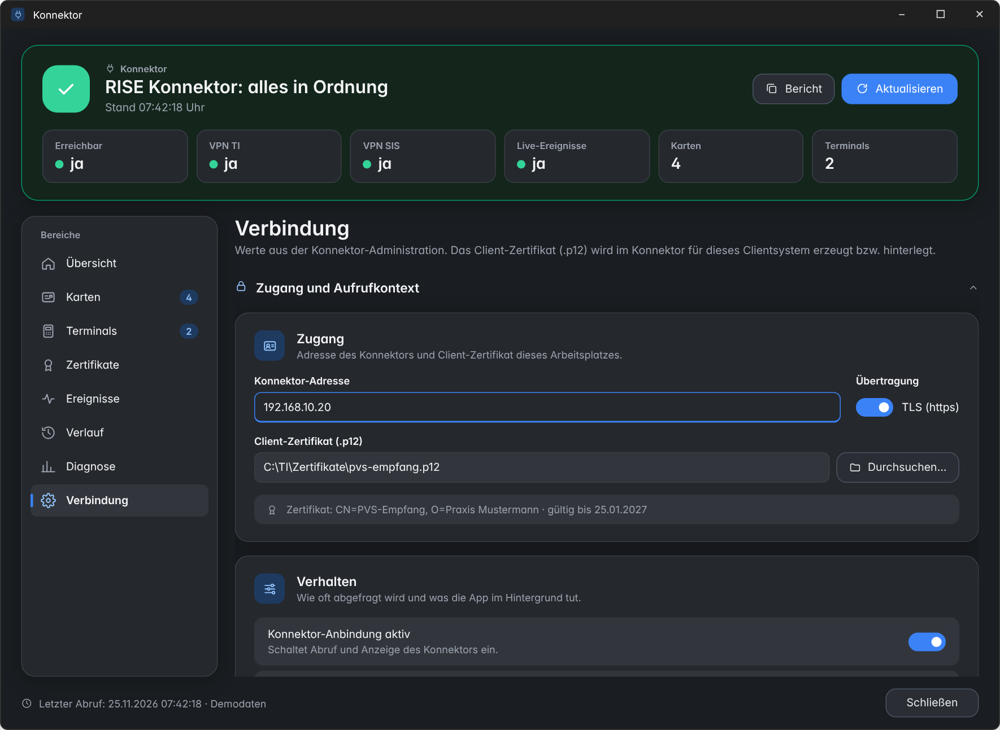

<p align="center">
  
</p>

<h1 align="center">TI-Lage Monitor</h1>

<p align="center">
  <strong>Der gematik-TI-Status und der lokale Konnektor — im Windows-Tray, lokal, ohne Login.</strong><br>
  <em>Fluent-Oberfläche · 14-Tage-Verlauf · optionale Konnektor-Anbindung</em>
</p>

<p align="center">
  <a href="https://github.com/JImmyB0nes/TILageMonitor/releases/latest"></a>
  <a href="https://github.com/JImmyB0nes/TILageMonitor/releases/latest"></a>
  
  
  
  <a href="https://github.com/JImmyB0nes/TILageMonitor/actions/workflows/ci.yml"></a>
  <a href="https://git.jimmybones.de/jimmybones/TILageMonitor"></a>
</p>

<p align="center">
  <a href="https://github.com/JImmyB0nes/TILageMonitor/releases/latest"><strong>Download</strong></a>
  ·
  <a href="#funktionen">Funktionen</a>
  ·
  <a href="#konnektor-anbindung">Konnektor</a>
  ·
  <a href="#installation">Installation</a>
  ·
  <a href="#sicherheit--datenschutz">Sicherheit</a>
  ·
  <a href="#faq--fehlerbehebung">FAQ</a>
  ·
  <a href="https://git.jimmybones.de/jimmybones/TILageMonitor">Forgejo-Mirror</a>
</p>

> [!IMPORTANT]
> **Kein offizielles gematik-Produkt.** TI-Lage Monitor ist eine unabhängige Community-App von Randy Carter (R.C.). Maßgeblich bleibt das [gematik Fachportal TI-Status](https://fachportal.gematik.de/ti-status#TI-Anschluss).

## Auf einen Blick

| Hellmodus | Dunkelmodus |
|:---:|:---:|
|  |  |

<p align="center">
  <a href="#konnektor-anbindung"></a><br>
  <sub>Konnektor-Fenster – Vorschau mit Demodaten</sub>
</p>

TI-Lage Monitor zeigt den aktuellen Status von **sieben TI-Diensten** als Tray-Ampel und im Fluent-Hauptfenster — inklusive Meldungen, Toasts und einem **14-Tage-Verlauf**. Optional kommt die **lokale Konnektor-Anbindung** hinzu (SDS, VPN TI/SIS, Karten, Terminals, PIN-Status, Live-Ereignisse). Alles läuft **lokal** auf Windows, ohne Login und ohne Cloud.

**X** oder Minimieren legt die App in den Tray (Monitoring läuft weiter). Nur **Beenden** beendet sie.

## Warum TI-Lage Monitor?

- **Lokal und privat** — öffentliche gematik-APIs, kein Account, keine Sync-Cloud
- **Immer im Blick** — Tray-Ampel und Toasts, ohne einen Portal-Tab offen zu lassen
- **14-Tage-Verlauf** — Übersicht, Stunden und Ereignisse auf einer Datenbasis; Störungsbericht als CSV
- **Konnektor optional** — Inventar und Überwachung im lokalen Netz, nach gemSpec_Kon
- **Aktuell bleiben** — GitHub-Releases mit SHA-256-Prüfung und optionaler Auto-Installation

## Funktionen

| | Funktion | Nutzen |
| :--: | --- | --- |
| 🛡️ | **Tray-Ampel** | Grün / Amber / Rot / Keine Daten im Infobereich |
| 🔎 | **7 TI-Dienste** | eRezept, ePA, KIM, WANDA, OGD, VSDM, TI-Anschluss |
| 🔔 | **Windows-Toasts** | Klickbare Benachrichtigungen mit Kontextsprung; Filter global und pro Dienst |
| 📈 | **14-Tage-Verlauf** | Übersicht · Stunden · Ereignisse — KPI, Fokus-Chips, Timeline |
| 📄 | **CSV-Störungsbericht** | Aus dem Verlaufsfenster: Semikolon-CSV, UTF-8 mit BOM, für Excel |
| 💬 | **Meldungen** | Aktuelle Störungen und Hinweise im Hauptfenster, mit umbrechendem Langtext |
| 🔌 | **Konnektor-Anbindung** | SDS, VPN TI/SIS, Karten, Terminals, Zertifikate, PIN-Status, CETP-Ereignisse, 14-Tage-Konnektor-Verlauf, Ablauf- und PIN-Warnungen |
| ⬇️ | **Update-Prüfung** | GitHub-Releases prüfen, SHA-256 verifizieren, optional still installieren |
| 🎨 | **Fluent-Oberfläche** | Hell-/Dunkelmodus, Sprache, Autostart, Start in den Tray |
| ⚙️ | **Einstellungen** | Karten für Sprache, Darstellung, Start, Updates, Benachrichtigungen und Konnektor |

**Statusfarben**

| Status | Bedeutung |
| --- | --- |
| 🟢 **Grün** | Überwachte Dienste verfügbar |
| 🟠 **Amber** | Einschränkung oder Teilausfall |
| 🔴 **Rot** | Vollausfall oder kritische Störung |
| ⚪ **Keine Daten** | API nicht erreichbar oder noch kein Abruf |

Lage (tilage **v2**), Incidents (**v1**) und Outages (**v1**) kommen von `ti-lage.prod.ccs.gematik.solutions`. Abrufe folgen dem gematik-Rhythmus mit Offset (`:01`, `:06`, `:11`, …). Nach **drei aufeinanderfolgenden** API-Fehlern gilt die API dauerhaft als nicht erreichbar, bis wieder ein Abruf gelingt.

## Installation

1. Die [neueste Version](https://github.com/JImmyB0nes/TILageMonitor/releases/latest) herunterladen (`TILageMonitor-*-Setup.exe`) und die SHA-256-Prüfsumme (`checksums.txt`) vergleichen.
2. Das Setup starten und die Installation abschließen.
3. Optional unter **Einstellungen** Autostart, Theme, Sprache, Updates und Konnektor festlegen.

> [!TIP]
> Der Installer ist offline und bringt .NET 10 sowie das Windows App SDK mit (win-x64, self-contained). Unter **Einstellungen → Updates** lässt sich die optionale stille Auto-Installation aktivieren. Downloads stammen nur von GitHub-Adressen und werden per **SHA-256** geprüft.

> [!WARNING]
> Die EXE ist derzeit **unsigniert**, sofern im Release-Workflow kein Signaturzertifikat hinterlegt ist. Windows SmartScreen kann warnen. Details und Signatur-Plan: [SIGNING.md](SIGNING.md).

### Bedienung

| Aktion | Wirkung |
| --- | --- |
| Linksklick auf das Tray-Icon | Hauptfenster ein- oder ausblenden |
| Schließen (X) / Minimieren | Nur in den Tray (Monitoring läuft weiter) |
| Rechtsklick → Benachrichtigungen | Toasts global an/aus |
| **Aktualisieren** | TI-Status sofort neu laden |
| **Verlauf** | 14-Tage-Historie (CSV-Export im Verlaufsfenster) |
| **Konnektor** | Konnektor-Fenster öffnen |
| **Einstellungen** | Sprache, Theme, Autostart, Updates, Filter, Konnektor-Verhalten |
| **gematik** | Fachportal im Browser |
| **Beenden** | App beenden |

## 14-Tage-Verlauf

Drei Segmente auf derselben Datenbasis: **Übersicht | Stunden | Ereignisse**.

| Baustein | Inhalt |
| --- | --- |
| **KPI** | Heute · 14 Tage (auffällige Tage) · Verfügbarkeit % |
| **Fokus-Chips** | Alle Dienste oder ein Dienst — Zeilen bzw. große Tageskacheln |
| **Timeline** | Karten mit Status-Balken; Klick zoomt in Stunden bzw. markiert Ereignisse |
| **CSV-Export** | Störungsbericht als Semikolon-CSV (UTF-8 mit BOM) |
| **Quellen** | gematik Incidents/Outages (auch bei ausgeschaltetem PC) und lokale Snapshots (`history.json`) für Online-Stunden |

> [!NOTE]
> Graue Kacheln oder Stunden bedeuten: weder lokaler Snapshot noch API-Meldung (zukünftige Stunden bleiben grau). Bei erreichbarer Incident-API gelten begonnene Stunden ohne Störung als verfügbar (grün).

| Tipp | Wirkung |
| --- | --- |
| Filter-Chip | Zeilen und Ereignisse eingrenzen |
| Tageskachel | Stunden-Zoom |
| Ereignis / auffällige Stunde | Zoom bzw. Segment **Ereignisse** |
| Esc / Zurück | Zurück zur Tagesübersicht |

## Konnektor-Anbindung

Optional liest die App den **lokalen TI-Konnektor** über die SOAP-Schnittstellen nach [gemSpec_Kon](https://fachportal.gematik.de/) / api-telematik OPB5 aus. Das gilt für Konnektoren dieses Vertragsstands — typischerweise **RISE**, **secunet** und **KoCoBox**. Die Einrichtung liegt unter **Konnektor** im Hauptfenster, im Tray-Menü oder über **Einstellungen**.

Die Hintergrundüberwachung ist **lesend** (Inventar, Status, Zertifikatsablauf, Ereignisse). PIN-Aktionen sind standardmäßig ausgeschaltet (Einstellungen → „PIN-Verwaltung erlauben“) und starten auch dann nur, wenn man sie ausdrücklich im Konnektor-Fenster anstößt; PIN und PUK werden **ausschließlich am Kartenterminal** eingegeben und die App sieht sie nie. Ein automatisches Auslesen der eGK-Versichertendaten (`ReadVSD`) findet nicht statt.

### So sieht es aus

> Vorschaubilder mit **Demodaten** (Praxis, Personen, Kartennummern und Telematik-IDs sind erfunden). Aufbau, Farben und Texte entsprechen dem Konnektor-Fenster ab Version 3.2.

<table>
  <tr>
    <td width="50%"></td>
    <td width="50%"></td>
  </tr>
  <tr>
    <td><b>Übersicht</b><br><sub>Zustand des Konnektors, Kennzahlen (Erreichbarkeit, VPN TI/SIS, Live-Ereignisse), gesteckte Karte und Eckdaten aus <code>connector.sds</code> – inklusive Uhrzeit-Abweichung.</sub></td>
    <td><b>Karten</b><br><sub>SMC-B, HBA und eGK mit Zustandspunkt und Zertifikatsbalken; Detailansicht mit Eigenschaften, Zertifikaten, PIN-Tabelle und Aktionen wie OCSP-Prüfung und QES-Probesignatur.</sub></td>
  </tr>
  <tr>
    <td></td>
    <td></td>
  </tr>
  <tr>
    <td><b>Zertifikate</b><br><sub>Resttage je Zertifikat mit Warnstufen 90/30/7 Tage; der <b>Ablaufkalender (.ics)</b> bringt alle Termine mit Erinnerungen nach Outlook.</sub></td>
    <td><b>Verbindung</b><br><sub>Adresse, Client-Zertifikat (P12) und Aufrufkontext; Schalter für Überwachung, Ereignis-Abos und lokalen Verlauf.</sub></td>
  </tr>
</table>

### Was ausgelesen wird

| Bereich | Quelle | Inhalt |
| --- | --- | --- |
| Konnektor | `connector.sds` | Hersteller, Produkt, PTV, Firmware/Hardware, angebotene Dienste und Versionen, TLS-Pflicht |
| Betriebszustand | `EventService.GetResourceInformation` | VPN TI und VPN SIS online/offline, aktive Fehlerzustände (`EC_*`) |
| Kartenterminals | `EventService.GetCardTerminals` | Name, CtId, IP, MAC, Slots, verbunden ja/nein |
| Karten | `EventService.GetCards` | SMC-B / SM-B / HSM-B, HBA, eGK, gSMC-KT: Inhaber, ICCSN, Slot, Ablaufdatum |
| PIN-Status | `CardService.GetPinStatus` | verifiziert, Transport-PIN, gesperrt, deaktiviert, Restversuche |
| Zertifikate | `CertificateService.ReadCardCertificate` | C.AUT, C.ENC, C.SIG, C.QES: Ablauf, Aussteller, Telematik-ID, Rolle |
| QES-Probesignatur | `SignatureService.GetJobNumber` / `SignDocument` | nur auf Knopfdruck: Testsignatur mit dem HBA (PIN.QES am Terminal) |
| Uhrzeit | HTTP-`Date`-Header jeder Antwort | Abweichung der Konnektor-Uhr gegenüber dem PC |
| Live-Ereignisse | EventService-Abo + **CETP** | `CARD/INSERTED`, `CARD/REMOVED`, `CT/CONNECTED`, `CT/DISCONNECTED`, `CERT/CARD/STATUS` |

**TLS:** Der HTTPS-Zugang zum Konnektor nutzt BouncyCastle (TLS 1.2, optional 1.3) mit **Brainpool** (P-256/P-384/P-512) und **RSA** bzw. NIST-Kurven. Das Clientsystem-Zertifikat (P12) wird nur im Speicher gehalten; die Kette geht vollständig mit. Beim ersten Verbinden wird der SHA-256-Fingerprint des Konnektor-Zertifikats angezeigt und nach Bestätigung **gepinnt**. Ist TLS im SDS oder in den Einstellungen vorgeschrieben, läuft auch die Ereignissenke über TLS (CETP1: die App ist TLS-Server, der Konnektor TLS-Client).

**Hintergrund-Toasts (abschaltbar):** Konnektor nicht erreichbar, TI-VPN offline, Fehlerzustände, Terminal getrennt, keine SMC-B gesteckt, Transport-PIN.

**Neu in 3.2:**
- **Neues Konnektor-Fenster** im Fluent-Stil: Kopf mit Zustand und Kennzahl-Kacheln, Navigationsleiste mit Zählern, Detailansichten mit Eigenschafts-Kacheln und PIN-Tabelle, Zertifikats-Kacheln mit Resttagen.
- **Erinnerung an die SMC-B-Freischaltung:** nach dem Start der App (PC-Neustart) und nachdem der Konnektor wieder erreichbar ist (Stromausfall, Neustart) erscheint ein Toast, wenn die SMC-B nicht PIN-verifiziert ist – mit Knopf **„Jetzt freischalten“**, der das Konnektor-Fenster öffnet und die PIN-Eingabe am Kartenterminal startet (erfordert „PIN-Verwaltung erlauben“).
- **Ablaufkalender:** im Bereich **Zertifikate** alle Zertifikatsabläufe als `.ics`-Datei für Outlook bzw. den Kalender exportieren – ganztägige Termine mit Erinnerungen 90, 30 und 7 Tage vorher. Erneuter Import aktualisiert die Termine statt sie zu verdoppeln.
- **QES-Probesignatur:** beim HBA prüft ein Knopf, ob qualifiziert signiert werden kann (`SignatureService.GetJobNumber` + `SignDocument`, CAdES über einen Testtext, PIN.QES am Kartenterminal) – nicht nur, ob die Karte gesteckt ist.
- **Zeitabweichung:** die Uhr des Konnektors wird bei jedem Abruf mit der PC-Uhr verglichen (HTTP-`Date`-Header). Ab 2 Minuten Abweichung gibt es eine Warnung, ab 5 Minuten einen Fehler – falsche Uhrzeiten brechen TLS und Signaturen. Der Wert steht auch in der Übersicht und im Bericht.
- Fehlerbehebungen: gelesene Zertifikate verschwinden nicht mehr nach dem nächsten Hintergrund-Abruf, Rückfall ohne Benutzer-ID gilt für den ganzen Abruf, C.QES neu gesteckter Karten wird sofort gelesen, robusteres Stoppen der Ereignissenke.

**Neu in 3.1:**
- **Zertifikats-Ablaufwarnung** für SMC-B, HBA und das Clientsystem-Zertifikat (P12) in drei Stufen — 90, 30 und 7 Tage vorher, dazu „abgelaufen“. Jede Stufe kommt je Zertifikat genau einmal, auch über Neustarts hinweg. Die Resttage stehen im Reiter **Zertifikate**.
- **PIN-Status-Warnung:** SMC-B nicht freigeschaltet (z. B. nach Konnektor-Neustart), PIN gesperrt oder nur noch ein Versuch (`GetPinStatus`). Gemeldet wird nur der Zustandswechsel.
- **Ereignis-Toasts** für `CARD/REMOVED` und `CT/DISCONNECTED` (optional auch `CARD/INSERTED` und `CT/CONNECTED`), filterbar nach Ereignis und Kartentyp (SMC-B, HBA). Die eGK wird nie gemeldet.
- **Konnektor-Verlauf (14 Tage)** im neuen Reiter **Verlauf**: erreichbar ja/nein, VPN TI, VPN SIS, SMC-B und HBA gesteckt — als Tageskacheln mit Stundenansicht.
- **Verständliche Fehlermeldungen:** gematik-Fehlercodes (GERROR) erscheinen mit Klartext nach gemSpec_Kon, z. B. `4004 – Ungültige Mandanten-ID` oder `4204 – Clientsystem aus dem Aufrufkontext konnte nicht authentifiziert werden`.
- **Automatische Wiederverbindung** mit exponentiellem Backoff (15 s bis höchstens 5 min, mit Jitter). Nach einem Konnektor-Neustart werden `connector.sds` neu gelesen und die Ereignis-Abos neu angelegt.

**Aktionen an SMC-B und HBA** (nur auf Knopfdruck und nur, wenn in den Einstellungen **„PIN-Verwaltung erlauben“** eingeschaltet ist – Standard: aus): PIN verifizieren, PIN bzw. Transport-PIN ändern, mit PUK entsperren, Zertifikat online prüfen (OCSP). Enable/Disable der PIN nur, wenn der Konnektor CardService 8.2 oder höher anbietet. HBA-qSig und vergleichbare Vorläufer zeigen typischerweise nur PIN.QES.

<details>
<summary><strong>Einrichtung Schritt für Schritt</strong></summary>

1. **Konnektor-Fenster öffnen** (Schaltfläche im Hauptfenster, Tray oder Einstellungen).
2. **Adresse eintragen:** IP oder Hostname, optional mit Port (z. B. `192.168.1.10` oder `10.0.0.5:8443`). TLS (https) bleibt in der Regel eingeschaltet.
3. **Clientzertifikat:** die `.p12`/`.pfx`-Datei des Clientsystems und das Passwort. Das Zertifikat muss in der Konnektor-Administration für dieses Clientsystem hinterlegt sein.
4. **Aufrufkontext** aus dem Infomodell: **Mandant-ID**, **Clientsystem-ID**, **Arbeitsplatz-ID**. Die Benutzer-ID ist optional (häufig für HBA-Operationen). Laut XSD höchstens 64 Zeichen. Viele Konnektoren (insbesondere RISE) akzeptieren faktisch nur `A-Z`, `a-z`, `0-9`, `-` und `_` — Punkte oder Leerzeichen warnt die App, blockiert das Speichern aber nicht; der Konnektor kann trotzdem mit `4000 Syntaxfehler` antworten.
5. **Freigaben im Infomodell:** Clientsystem und Arbeitsplatz müssen existieren, das Clientsystem-Zertifikat muss zugeordnet sein, und der Arbeitsplatz darf die benötigten Dienste (EventService, CardService, CertificateService) nutzen.
6. **Speichern und verbinden.** Beim ersten TLS-Handshake erscheint der Fingerprint — mit der Anzeige in der Konnektor-Administration vergleichen und nur dann **vertrauen**.
7. **Ereignis-Abos** (optional): Die App lauscht auf einem lokalen TCP-Port ab **48150** (bei Belegung die nächsten freien Ports). Die Windows-Firewall muss eingehende Verbindungen **vom Konnektor** auf diesen Port erlauben. Die Senke akzeptiert nur die aufgelöste Konnektor-IP. Ohne Abo pollt die App im eingestellten Intervall (Standard 5 Minuten).
8. Unter **Einstellungen** oder im Reiter **Verbindung** lassen sich Überwachung, Ereignis-Abos, lokaler Konnektor-Verlauf (14 Tage) und die Warnfrist für Zertifikate steuern.

Das Diagnose-Protokoll und **Bericht kopieren** erzeugen einen Text **ohne Passwörter**.

</details>

<details>
<summary><strong>Wenn Karten oder Terminals leer bleiben (4000 Syntaxfehler)</strong></summary>

Dieser Fehler kommt fast nie vom SOAP-Aufbau, sondern vom **Aufrufkontext**. Stimmen Mandant, Clientsystem oder Arbeitsplatz nicht mit der Administration überein oder enthalten sie Zeichen, die die Firmware ablehnt, schlägt die EventService-Abfrage insgesamt fehl. Die App wiederholt testweise ohne Benutzer-ID (das Ergebnis wird gemerkt) und ohne Mandanten-Radius und schreibt den gesendeten Request ins Protokoll. Die IDs bitte Zeichen für Zeichen mit der Konnektor-Administration vergleichen.

</details>

## Sicherheit und Datenschutz

- Für den TI-Status nur öffentliche gematik-APIs — **kein Login, kein API-Key**
- Die Konnektor-Anbindung bleibt im **lokalen Netz**; Passwörter liegen mit Windows-DPAPI (nur aktueller Benutzer) in `settings.json`
- Der private Schlüssel der P12-Datei wird nur im Speicher gehalten, nicht in den Windows-Zertifikatsspeicher importiert
- Der CETP-Listener nimmt ausschließlich Verbindungen der Konnektor-Adresse an
- Keine Cloud-Synchronisation
- Updates nur von allowlisted GitHub-Hosts (`github.com`, `*.githubusercontent.com`), Prüfung per SHA-256

Lokal unter `%AppData%\TILageMonitor\`:

| Datei | Inhalt |
| --- | --- |
| `settings.json` | Theme, Sprache, Autostart, Notify-Filter, Updates, Konnektor-Zugang (Passwörter DPAPI-verschlüsselt) |
| `last-lage.json` | Offline-Cache des letzten TI-Stands |
| `history.json` | Stündliche lokale Ergänzung zum TI-Verlauf |
| `connector-history.json` | Optionaler lokaler Konnektor-Verlauf (14 Tage) |
| `connector-warnings.json` | Bereits gemeldete Ablaufstufen und PIN-Zustände (gegen doppelte Toasts) |

<details>
<summary><strong>API-Endpunkte (gematik TI-Status)</strong></summary>

- `https://ti-lage.prod.ccs.gematik.solutions/lageapi/v2/tilage`
- `https://ti-lage.prod.ccs.gematik.solutions/lageapi/v1/tistatus/incident`
- `https://ti-lage.prod.ccs.gematik.solutions/lageapi/v1/tistatus/outage`

</details>

## FAQ und Fehlerbehebung

<details>
<summary><strong>Windows SmartScreen warnt vor der Installation</strong></summary>

Die aktuelle Release-EXE ist typischerweise **unsigniert** (kein hinterlegtes Authenticode-Zertifikat). Unter „Weitere Informationen“ kann die Ausführung trotzdem zugelassen werden, wenn die Quelle dieses Repository und die SHA-256-Summe in `checksums.txt` stimmen. Hintergrund und Signatur-Plan: [SIGNING.md](SIGNING.md).

</details>

<details>
<summary><strong>TLS-Fehler beim Konnektor („keine gemeinsame Cipher-Suite/Kurve“, Handshake schlägt fehl)</strong></summary>

- Clientzertifikat (P12) und Passwort prüfen; Brainpool- und RSA-Zertifikate werden unterstützt.
- Das Zertifikat muss im Konnektor für genau dieses Clientsystem hinterlegt sein.
- TLS (https) einschalten, wenn der Konnektor TLS vorschreibt (`TLSMandatory` in `connector.sds`).
- Den gepinnten Fingerprint unter **Vertrauen zurücksetzen** entfernen, falls das Konnektor-Zertifikat erneuert wurde, und erneut vergleichen.
- Adresse und Port prüfen; der Arbeitsplatz muss den Konnektor im Netz erreichen.

</details>

<details>
<summary><strong>Ereignisse (Karte rein/raus) kommen nicht an</strong></summary>

- Ereignis-Abos in den Einstellungen einschalten und einmal neu verbinden.
- In der Windows-Firewall eingehende TCP-Verbindungen vom Konnektor auf Port **48150** (oder den im Protokoll genannten Folgeport) erlauben.
- Im Konnektor-Fenster unter **Ereignisse** prüfen, ob Abos dieser App stehen. Schlägt das Abo fehl, pollt die App weiter im Intervall.

</details>

<details>
<summary><strong>Die App startet nicht oder der TI-Status bleibt leer</strong></summary>

Windows 10 oder 11 **x64** wird benötigt (siehe Systemanforderungen). Liegt die gematik-API nicht an, bleibt der letzte Stand aus `last-lage.json` sichtbar, sobald einer vorhanden ist. „Aktualisieren“ erzwingt einen neuen Versuch.

</details>

## Systemanforderungen

| | |
| --- | --- |
| Betriebssystem | Windows 10 oder 11, **64-Bit** (x64), ab Windows 10 Version 1809 |
| Architektur | win-x64 (kein ARM, kein 32-Bit) |
| Laufzeit | Im Installer enthalten (.NET 10 und Windows App SDK, self-contained) |
| Netz | Internetzugang für den gematik-TI-Status; LAN-Zugang zum Konnektor nur bei Nutzung der Konnektor-Anbindung |
| Entwicklung | [.NET 10 SDK](https://dotnet.microsoft.com/download/dotnet/10.0), PowerShell 5.1+ |

## Changelog

Neue Versionen und Installer stehen unter [Releases](https://github.com/JImmyB0nes/TILageMonitor/releases). Eine stabile Version ersetzt die gleichnummerierte Vorabversion (z. B. 3.0.0 nach einer 3.0.0-beta).

## Lizenz

Veröffentlicht unter der [MIT-Lizenz](LICENSE). Copyright © 2026 Randy Carter.

## Sprache / Language

**DE:** Unter **Einstellungen → Sprache** stehen **Automatisch (Windows)** · **Deutsch** · **Englisch**. Die Auswahl greift nach einem **Neustart** der App.

**EN:** Under **Settings → Language** choose **Automatic (Windows)** · **German** · **English**. The selection takes effect after **restarting** the app.

<details>
<summary><strong>Für Entwickler</strong></summary>

```powershell
git clone https://github.com/JImmyB0nes/TILageMonitor.git
cd TILageMonitor
.\Build.ps1
.\Install.ps1
```

| Bereich | Dateien |
| --- | --- |
| UI und Tray | `MainWindow.*`, `App.xaml(.cs)` |
| API und Modelle | `ApiClient.cs`, `Models.cs`, `TiStatusClassifier.cs` |
| Persistenz | `*Store.cs`, `AtomicJsonStore.cs` |
| Verlauf | `HistoryWindow.*`, `HistoryTimelineBuilder.cs`, `IncidentReportExporter.cs` |
| Konnektor | `Connector*.cs`, `CertificatePinning.cs` |
| Fenster / System | `SettingsWindow.*`, `AboutWindow.*`, `ToastService.cs`, `ThemeService.cs`, `AutostartService.cs`, `UpdateService.cs`, `LocalizationService.cs` |
| Build / Release | `Build.ps1`, `Install.ps1`, `installer/`, `.github/workflows/` |

**Stack:** WPF + WinForms-Tray · `net10.0-windows` · Windows App SDK Toasts · Inno Setup · MIT

</details>

---

**Randy Carter** (R.C.) · © 2026 · Community-App, nicht gematik

<p align="center">
  <sub>Für Praxen und IT, die TI-Status und Konnektor im Blick behalten — ohne einen Portal-Tab offen zu lassen.</sub>
</p>
